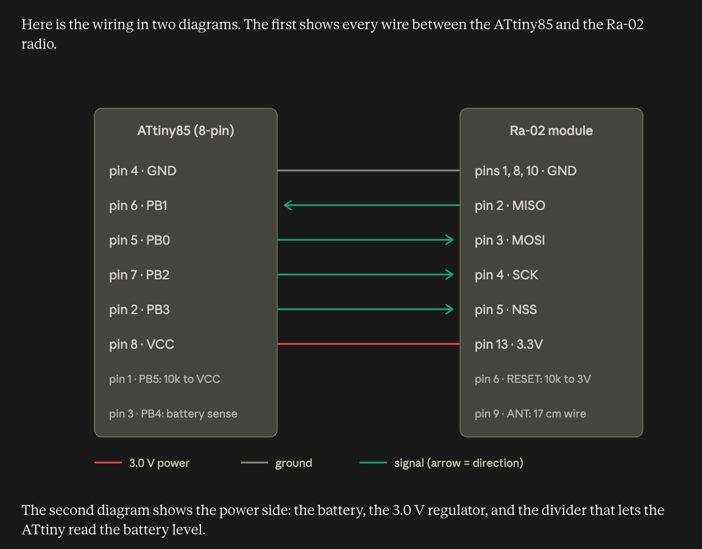
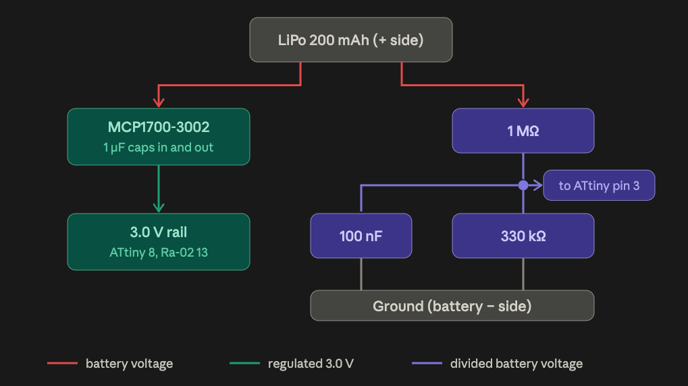

# ATtiny85 Collar — Setup

ATtiny85 + RA-02 (SX1278, 433 MHz) on a 3.0 V MCP1700 rail, from a LiPo.

This is a port of `collar/collar.ino` (nRF52840) to a 1 MHz ATtiny85. **Same
air settings, same 6-byte frame**, so the handheld, the phone app, the base
station and `tools/monitor.py` work unchanged. Register values are copied from
the nRF52840 build.




## What is different from the nRF collar

- **No serial, no logging, no LED.** There is no cable to plug in. `-DDEV_MODE`
  only makes the collar read the battery on every ping; the way to see it is
  `tools/monitor.py` or `tools/ble_roster.py` against the handheld. A build
  that is not heard looks exactly like a build that is not transmitting.
- **Sleep is power-down on the watchdog**, one 8 s watchdog period per
  `PING_TICKS`. The watchdog oscillator is not accurate — a nominal 8 s is
  really 7–10 s — which is the timing problem below.
- **SPI is bit-banged** on PB0/PB1/PB2 (the USI is not used), mode 0, MSB first.
- **No DIO0 wire.** `sendPacket()` polls the IRQ flags register for TxDone,
  so nothing is attached to the RA-02's DIO pads. A wire on one of them is
  doing nothing, and a long wire on a floating pad picks up noise.

## Wiring (ATtiny85 → RA-02)

| ATtiny | Pin | Ra-02 |
|--------|-----|-------|
| PB0 | pin 5 | MOSI |
| PB1 | pin 6 | MISO |
| PB2 | pin 7 | SCK |
| PB3 | pin 2 | NSS (chip select) |
| PB4 | pin 3 | ← battery divider midpoint (1 MΩ to VBAT, 330 kΩ to GND, 100 nF to GND) |
| PB5 | pin 1 | RESET — keep it as reset, 10 kΩ pull-up to VCC |
| — | — | RA-02 RESET → VCC through 10 kΩ (no MCU pin for it); DIO0–DIO4 not connected |

VCC is 3.0 V from an MCP1700-3002 LDO.

**PB0/PB1/PB2 are the ISP programming pins as well as the SPI bus.** That is
fine while flashing: NSS idles high, so the RA-02 ignores the bus. It is not
fine at 5 V — see the programming section.

## Parts the diagrams do not draw

Both diagrams share one ground: battery minus, regulator ground, ATtiny pin 4,
and the three RA-02 ground pins are all the same node. The missing parts:

- **ATtiny decoupling:** 100 nF across ATtiny pin 8 and pin 4, as close to the
  chip as possible. The ATtiny85 datasheet does not ask for it; ATTinyCore's
  own notes do, and boards that omit it are the classic failure.
- **Rail capacitor:** 100 µF low-ESR (or 47 µF ceramic) across the 3.0 V rail
  and ground, right next to the RA-02. It supplies the ~140 ms transmit burst.
- **Pull-ups:** 10 kΩ from ATtiny pin 1 to the 3.0 V rail, and 10 kΩ from
  RA-02 RESET (pin 6) to the 3.0 V rail.
- **Antenna:** about 16.5 cm of thin wire soldered to the RA-02 ANT pad
  (quarter wave at 433 MHz ≈ 17.3 cm; 16.5 cm with velocity factor). Keep it
  straight and away from the battery.

## Reading the pins

- **ATtiny85:** hold the chip with the dot/notch at the top. Pin 1 is
  top-left; count down the left side, then up the right side.
- **RA-02:** pads are 2 mm pitch — use a 2 mm → 2.54 mm adapter board for
  breadboarding, and confirm pin numbers against the AI-Thinker datasheet
  before powering up.
- **MCP1700:** pin order differs by package. TO-92 is GND, VIN, VOUT; SOT-23 is
  GND, VOUT, VIN. Check the datasheet for the one you have.
- **LiPo plug:** many LiPos are wired with reversed polarity on the plug.
  Check with a multimeter before connecting.

## Build options

All four are compile-time flags, and all four are baked into the binary — there
is nothing to change on the board afterwards.

| Flag | Default | Meaning |
|------|---------|---------|
| `-DCOLLAR_ID=n` | 0 | 0, 1 or 2. Two collars with the same id are not two cats. |
| `-DPING_TICKS=n` | 1 | Units of one 8 s watchdog sleep. 1 = ~8 s, 8 = ~64 s. |
| `-DTX_POWER=n` | 17 | dBm, 2..17, PA_BOOST path. Lower = longer battery, less range. |
| `-DBATT_VREF_MV=n` | 1100 | The 1.1 V reference, for calibration. |
| `-DDEV_MODE` | off | Read the battery on every ping. |

The collar id also shifts the phase: every collar adds one extra second per id
so two collars cannot stay locked together. See the timing section.

## Which board is which cat

`cats.json` in the repo root is the name table (`0: Chichi, 1: Onanda,
2: Chacha`), so the ids are shared between the nRF collars and the ATtiny
collars. Keep the record here, because **an ATtiny has no USB serial and no
device id** — the nRF collar can be identified before you flash it, and this
one cannot. Write the id on the board.

| id | cat | board | note |
|----|-----|-------|------|
| 0 | Chichi | nRF52840 Pro Micro | |
| 1 | Onanda | nRF52840 Pro Micro | |
| 2 | Chacha | ATtiny85 + RA-02 | built from the broken nRF board's RA-02 and cell |

Collar 2 is the one that gets the 1 s/id phase stagger, which is why the
handheld's window is sized from it. Two collars with the same id merge into
one row in the app, in `monitor.py`, and in the base station's "last heard" —
that failure is silent, and `missed` counts gaps from two transmitters.

## Compile and flash

`arduino-cli upload` does **not** compile; it sends the artifacts of the last
build of that sketch. `--output-dir` / `--input-dir` pin the exact build, so a
stray compile cannot put the wrong collar id on a board with no error at all.
That is the same rule as the nRF collar.

```bash
# One line each, wrapped here for readability.
arduino-cli compile \
  --fqbn "ATTinyCore:avr:attinyx5:chip=85,clock=1internal,millis=disabled,bod=disable" \
  --build-property "compiler.cpp.extra_flags=-DCOLLAR_ID=2 -DPING_TICKS=1" \
  --output-dir /tmp/collar85 at-tiny85-collar
arduino-cli upload --programmer usbasp \
  --fqbn "ATTinyCore:avr:attinyx5:chip=85,clock=1internal,millis=disabled,bod=disable" \
  --input-dir /tmp/collar85
```

Board selection: **ATTinyCore → ATtiny25/45/85 (attinyx5)**, chip ATtiny85,
clock **1 MHz internal**, B.O.D. **disabled**, **millis disabled**:

```bash
ATTinyCore:avr:attinyx5:chip=85,clock=1internal,millis=disabled,bod=disable
```

Run `arduino-cli board details -b ATTinyCore:avr:attinyx5` to confirm the
option names for the version you have installed. Verified against ATTinyCore
1.5.2: `chip=85`, `clock=1internal`, `millis=disabled`, `bod=disable` are the
option names, and the default `clock=8internal` is **not** what this build wants.

Two mechanical things:

- **The sketch folder and the `.ino` share the name** (`at-tiny85-collar/
  at-tiny85-collar.ino`). `arduino-cli` compiles by folder, and it demands a
  main file named after the folder — the old `collar_attiny85.ino` inside
  `at-tiny85-collar/` failed with "main file missing from sketch" and no
  other clue.
- **ATTinyCore is not in the official boards manager index**, and its own
  index host (`drazzy.com`) has an **expired TLS certificate**, so
  `arduino-cli core install ATTinyCore:avr` fails both ways. It is installed
  here by cloning the maintainer's repo into the sketchbook's hardware folder:
  `git clone --depth 1 --branch 1.5.2 https://github.com/SpenceKonde/ATTinyCore
  ~/Documents/Arduino/hardware/ATTinyCore` → FQBN `ATTinyCore:avr`. Do that
  on the flashing machine before the first build.

- **`millis=disabled`** is real (`-DDISABLEMILLIS`) and saves flash, which is
  what the sketch header means by "millis disabled". It is not required:
  `setup()` calls `power_timer0_disable()` and `power_timer1_disable()` itself,
  so `millis()` never advances even in the enabled build. Pick the disabled
  build, keep the FQBN identical for every collar, and do not mix the two.
- **Choosing clock or B.O.D. in the board menu does not write the fuses.** An
  ISP upload writes the sketch only. Changing a fuse needs a burn-bootloader /
  fuse-write step with the programmer, which is what you want to avoid here.

## Programming with a USBasp

The programmer on the bench is a **USBasp** (fischl.de, USB vendor `0x16c0`
/ product `0x05dc` — `system_profiler SPUSBDataType | grep -i usbasp` shows it).
It needs no ArduinoISP sketch and **no 10 µF reset capacitor**: those are the
Uno-as-ISP workaround for the Uno auto-resetting on open, and a USBasp has no
auto-reset line.

Wire the standard **2x5** (10-pin) ISP connector to the **bare chip**. Its odd
pins are signals and its even pins are supply — but **pin 2 is VCC, not GND**.
That asymmetry is the whole hazard: a table that assumes "even pins are all
GND" grounds the chip's VCC and puts 5 V on its GND.

| 10-pin ISP | Signal | ATtiny85 |
|-----|--------|----------|
| 1 | MOSI | pin 5 (PB0) |
| 2 | VCC | pin 8 (VCC) |
| 4, 6, 8, 10 | GND | pin 4 (GND) |
| 5 | RESET | pin 1 (PB5) |
| 7 | SCK | pin 7 (PB2) |
| 9 | MISO | pin 6 (PB1) |
| 3 | not connected | — |

**An earlier version of this table was wrong, and it destroyed a chip.** It
numbered the header as if it were the 6-pin connector — `pin 1 RESET`, `pin 3
SCK`, `pin 5 MOSI`, `pin 7 MISO`, `pin 4 VCC`, "any even pin GND" — which on a
real 10-pin header is GND onto the chip's VCC and 5 V onto its GND. Wired that
way the ATtiny reverse-biases and emits smoke on first connection. If you have
that table on paper, discard it.

**Verify the header with a meter before a chip is ever on the cable.** No chip
attached, USBasp plugged in: pin 2 against any even pin must read ~5 V, and
pins 4, 6, 8, 10 must read 0 V. Two minutes of this is cheaper than a dead
ATtiny, and it catches a reversed ribbon too.

`arduino-cli` needs the programmer registered in its config
(`~/Library/Arduino15/arduino-cli.yaml`) before `--programmer usbasp` works —
there is no usbasp entry in the default config:

```yaml
programmers:
    - name: usbasp
      hardware: avr
      port: usb
      protocol: usbasp
      board: ''
      checks:
        - {port, usb}
        - {programming, usbasp}
```

**Check the wiring before writing flash.** `avrdude` is not on `PATH`; it is the
arduino-cli tool package, `~/Library/Arduino15/packages/arduino/tools/avrdude/*/bin/avrdude`.
A signature read writes nothing:

```bash
AVR=~/Library/Arduino15/packages/arduino/tools/avrdude/8.0.0-arduino1/bin/avrdude
CONF=${AVR%/bin/avrdude}/etc/avrdude.conf
$AVR -C $CONF -c usbasp -p t85 -P usb -v
```

It prints `Signature : 0x1e 0x93 0x0b` for an ATtiny85. If it says **`target
does not answer (0x01)`** the USBasp is on the bus and working (it was found and
answered), and the chip is not: power, the reset line, MOSI/MISO swapped, or the
ATtiny pin numbering. Count pins from the dot/notch: pin 1 is top-left, down the
left side, then up the right. Try a slower clock (`-B 8`, `-B 60`); note that
**`-b` is the serial baud-rate flag and the USBasp ignores it silently**, so a
`-b` run looks like a speed change while nothing has changed. `-B` prints `Set
SCK frequency to … Hz` when it takes effect — if that line is absent, the
firmware does not support it. If `-B` speeds fail identically the speed is not
the problem. A chip that had its reset fuse disabled will not answer ISP at all,
and needs high-voltage programming.

`-F` forces past the check and prints the bytes the bus actually returned, which
separates "not talking" from "talking badly":

```bash
$AVR -C $CONF -c usbasp -p t85 -P usb -F -v
```

`Device signature = 00 00 00` means **MISO never went high**: the chip is
unpowered, the reset wire is not on pin 1, MOSI and MISO are swapped, or a
powered RA-02 is sharing the line. A powered RA-02 is the in-circuit trap:
MOSI/MISO/SCK are wired straight through to the module, so its MISO output sits
on the ISP MISO line and a **nonzero** signature from a chip that will not
program is the swap / disabled-reset case, not a wiring break.

Many USBasp clones supply 5 V on the VCC pin; check yours **with a meter,
before a chip is on the cable** (pin 2 to an even pin ≈ 5 V, and pin 2 to pin 4
must not read a short). If it does not supply VCC, the ATtiny must be powered
externally, and its GND joined to the programmer's GND — a shared ground is what
makes an unpowered chip look like a dead one.

## Programming with an Arduino Uno as ISP

Upload the ArduinoISP example sketch to the Uno first, then wire it to the
**bare chip**:

| Uno | ATtiny85 |
|-----|----------|
| D10 | pin 1 (reset) |
| D11 | pin 5 (PB0 / MOSI) |
| D12 | pin 6 (PB1 / MISO) |
| D13 | pin 7 (PB2 / SCK) |
| 5V | pin 8 (VCC) |
| GND | pin 4 (GND) |

Put a 10 µF capacitor from the Uno's RESET to its GND (plus leg to RESET);
without it the Uno auto-resets on programming and the flash fails.

**Program the ATtiny on its own, with no RA-02 attached.** ISP runs at 5 V, and
5 V on the SPI pads of a 3.3 V SX1278 is past its absolute maximum — the Ra-02
can latch up or die. NSS idling high means the chip ignores the *signals*; it
does not make 5 V safe on the pads.

**Fuses:** a new ATtiny85 comes from the factory at 1 MHz internal RC, reset
enabled, B.O.D. disabled, which is what this build wants. Do not change them,
and **never disable the reset pin**: PB5 is both the reset pin and the ISP
reset line, and on this build it is also held high by a pull-up.

## Build order

1. Program the ATtiny on its own, 5 V, no RA-02. Use the table under
   "Programming with a USBasp" and do the meter check there **first** — header
   pin 2 is VCC, and a chip wired with it grounded is destroyed on connection.
2. Power-only test: battery and regulator only, measure ~3.0 V at the rail
   before adding anything else. A sagging rail on a small LiPo is the most
   likely first-power-up problem, and the transmit burst is what shows it.
3. Add the ATtiny with its decoupling cap and reset pull-up.
4. Add the RA-02 and its rail capacitor.
5. Add the signal wires.

Once flashed, put the chip into the collar circuit. There is no LED on this
build, so the test is whether the handheld hears the collar: power up with
`-DDEV_MODE` and run `python3 tools/monitor.py`. If nothing shows up, note
what the multimeter reads at the 3.0 V rail, and work down from the top of
this list.

## Timing: the thing to measure on the bench

The effective period is **`PING_TICKS × 8 s + COLLAR_ID seconds`** — the id
phase shift is not optional. So at `PING_TICKS=1`: collar 0 ≈ 8 s, collar 1
≈ 9 s, collar 2 ≈ 10 s. Add the watchdog oscillator's drift (7–10 s for a
nominal 8 s) and collar 2 can run 12–13 s.

The two constants in `handheld_ble/handheld_ble.ino:136` and
`homebase/homebase.ino:101` are sized from the beacon period:

- `RX_TIMEOUT_MS = COLLAR_PING_MS + 200`. `radio.receive()` blocks for that
  long waiting for a preamble, so the window has to cover a full ping period
  of the **slowest** collar, or most of every ping is dropped.
- `STALE_MS = 15000` marks a cat stale when it has not been heard for 15 s.

**They are set for the ATtiny's stagger now.** `COLLAR_PING_MS` is
`8000 + (MAX_COLLARS - 1) * 1000 + 1000` = 11000, so `RX_TIMEOUT_MS` is 11200.
That covers `PING_TICKS=1` at every id: the stagger here is **1000 ms per id**
(`sleepFor(WDTO_1S)`), not `collar/collar.ino`'s `PING_PERIOD_STEP_MS` = 137 ms,
so id 2 pings every ~10 s nominal, ~13 s at the fast end of the watchdog
oscillator. `STALE_MS` 15000 stays above that, so it does not move. `receive()`
returns as soon as a preamble arrives, so the longer window costs nothing in
latency, and the 2 s keep-alive task keeps the BLE link warm through it.

Before this change the window was 8474 ms, and collar 2's pings landed outside
it about once in seven — which showed up as `missed` in `tools/monitor.py`, not
as an error.

**At `PING_TICKS=8` the ATtiny is still invisible to a handheld.** A ~66 s
beacon against an 11.2 s window means the handheld hears a packet only when its
window happens to be open at the moment the collar transmits — roughly one ping
in six. A window long enough to cover 66 s would make `STALE_MS` useless for
every nRF collar, so the window and the stale threshold have to become
**per-collar** before `PING_TICKS=8` is usable. That is the open change.

Measure the real period on the bench, for each collar, and check it against
these numbers:

```bash
python3 tools/monitor.py --csv > tiny.csv   # Ctrl-C stops it
python3 - <<'EOF'
import collections
# --csv rows have no header: time, report t, id, name, rssi, rssi_raw, snr,
# batt, packets, missed, age, flags (tools/monitor.py:385)
by = collections.defaultdict(list)
for line in open('tiny.csv'):
    f = line.split(',')
    if len(f) > 2:
        by[int(f[2])].append(float(f[0]))
for cid, ts in sorted(by.items()):
    gaps = [b - a for a, b in zip(ts, ts[1:])]
    print(cid, len(ts), 'min', min(gaps), 'max', max(gaps))
EOF
```

The gap between rows for the same id is what you are reading: if the max is
above ~13 s the collar is drifting and `COLLAR_PING_MS` has to grow. `missed`
(column 10) counts the pings the window dropped.

## Battery life vs homing

These pull in opposite directions, and the choice is per deployment, not
per build:

| `PING_TICKS` | Period | Battery (≈200 mAh, from the firmware's estimate) | Homing |
|---|---|---|---|
| 1 | ~8 s | about 4 days | responsive — beeps you can walk towards |
| 8 | ~64 s | about 5 weeks | too slow to walk towards |

Range-test at 1, deploy at 8 — **but deploying at 8 needs a handheld change
first**, for the reason in the timing section.

**Calibrate the battery reading.** The internal 1.1 V reference is accurate to
about ±10%, which is more than the percentage scale can absorb. Measure the
real cell voltage with a multimeter, compare it with the reported value, and
set `BATT_VREF_MV` to `old × measured / reported` before trusting the
percentage.

The divider and its 100 nF capacitor are permanently connected, so the sense
node is already settled when the ADC samples it — there is no settling wait,
and the code discards the first conversion after a short reference settle
instead. The battery is read **before** transmit, so the cell is not sagging
when it is sampled.

## Before you change the radio code

This build is a **fifth copy** of the air settings and the packet frame:
`collar/`, `handheld_ble/`, `homebase/homebase.ino`,
`homebase/esphome/cat-base2.yaml`, and `at-tiny85-collar/`. AGENTS.md's "match
all four" rule predates this port and does not list it. A base station built
with different air settings receives nothing, which looks exactly like a dead
module; and the frame carries the collar id, so a frame mismatch does not fail
loudly — it merges two cats into one row, or hides one.

The host test for the base station's decode is
`c++ -std=c++17 -o /tmp/t homebase/esphome/test_collar_frame.cpp && /tmp/t`.
There is no host test for the ATtiny build, so the ATtiny side has to be
checked against the handheld on the bench.
