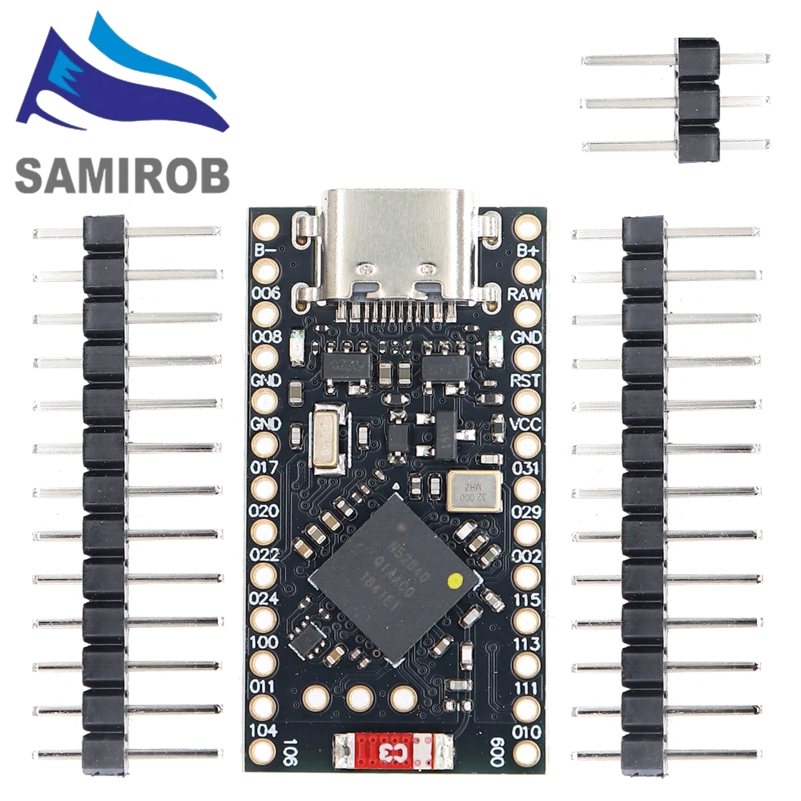
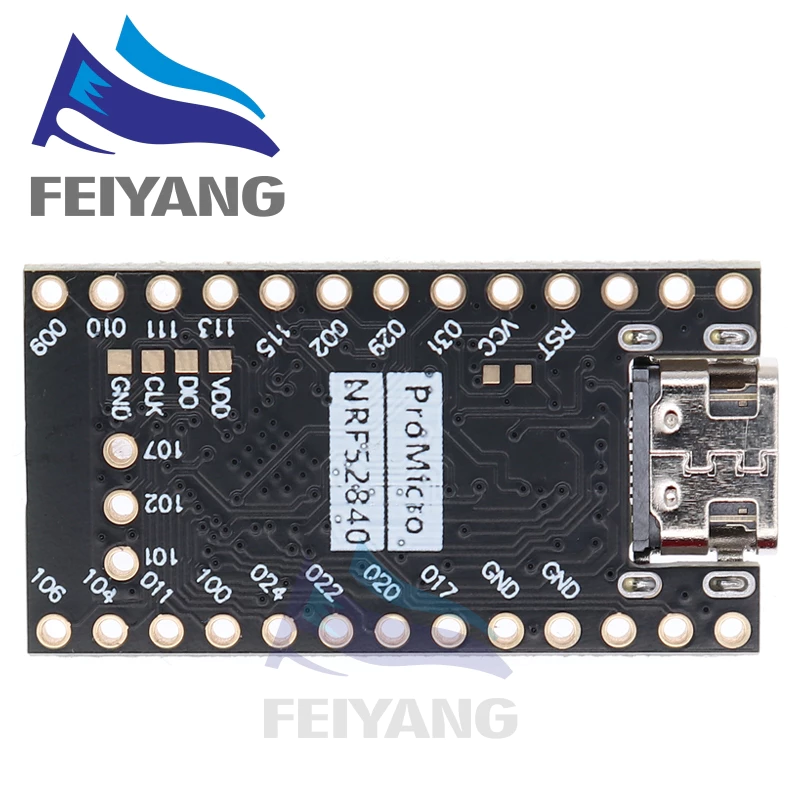
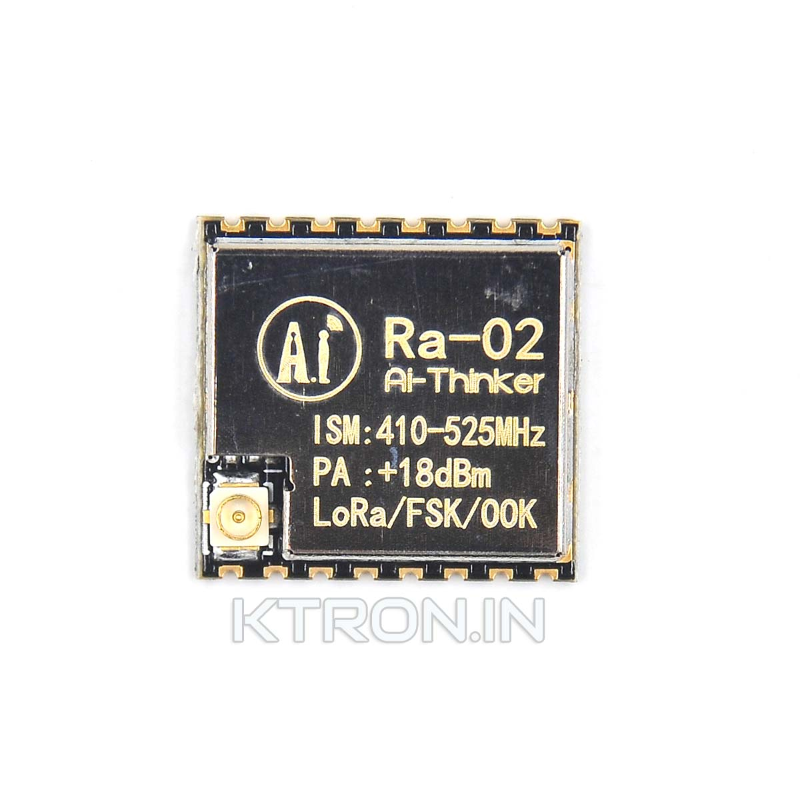
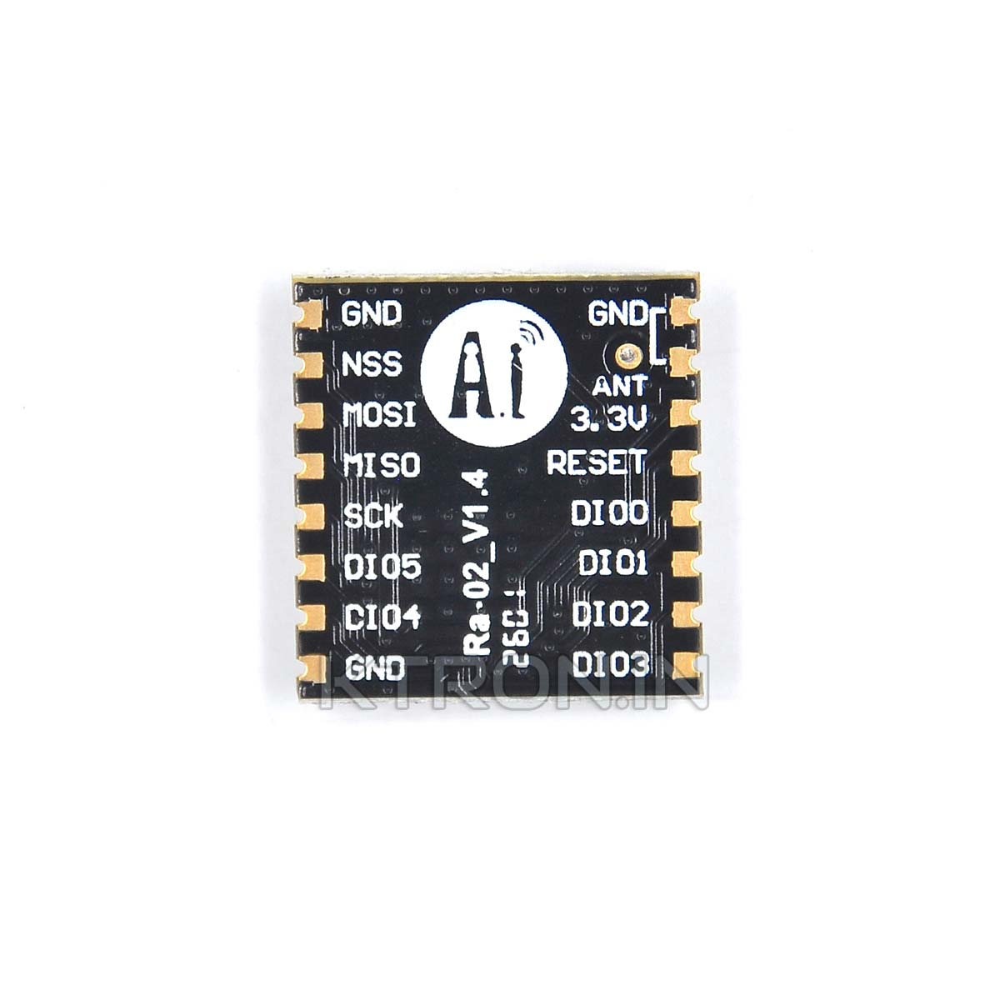

# Cat Collar Transmitter — Setup

TENSTAR ROBOT nRF52840 Pro Micro + RA-02 (SX1278, 433 MHz), powered by a
150 mAh LiPo. Pings every 8 s; the handheld at `../handheld_ble`
receives them and forwards the signal to the phone.

Several collars can run at once: each is flashed with its own id
(`-DCOLLAR_ID=0|1|2`) and carries it in every packet. See "Packet format"
below.

The SPI pins are **bit-banged in software** — the nRF52840's hardware SPI is
not used. See "Why bit-banged SPI" below.

## The two boards

The collar is two modules and a cell. Both boards label their pads directly,
and this project uses those labels verbatim, so the pin-side photos are the
ones worth keeping to hand (see "Wiring").

**TENSTAR nRF52840 Pro Micro** — component side, then the labelled back:




**RA-02 (SX1278, 433 MHz)** — shielded top, then the pinout:




## Board selection in Arduino

Board: **Adafruit Feather nRF52840 Express** (`adafruit:nrf52:feather52840`)

The board is silkscreened *TENSTAR ROBOT Pro Micro* but enumerates as the
Adafruit Feather. Select the Adafruit board; it works.

## Wiring (RA-02 → nRF52840)

The RA-02 SPI pads are identified by their **silkscreen labels**, not by pin
number. Match by label. The five wires below are the complete list.

| RA-02 pad | Function | Pro Micro label | Also written |
|------------|----------|-----------------|--------------|
| 1, 2, 9 | **GND** | GND | use either GND pad |
| 3 | **3.3V** | 3.3V / VCC | **3.3 V only.** Never 5 V. |
| 4 | **RESET** | `031` | P0.31 |
| — | **SCK** | `011` | P0.11 |
| — | **MISO** | `002` | P0.02 |
| — | **MOSI** | `015` | P1.15 |
| — | **NSS / CS** | `013` | P1.13 |
| — | **ANT** | antenna + counterpoise | IPEX socket or ANT pad |
| 5, 6, 7, 8, 10 | DIO0–DIO4 | **not connected** | unused |

**DIO0–DIO3 are deliberately left unconnected.** The firmware polls the SX1278's
IRQ flags register for TxDone instead of using the DIO0 interrupt pin
(`collar/collar.ino:228`), so nothing needs to be attached to them. If you have
a wire on one, it is doing nothing — and a long wire on a floating pad picks up
noise, which is worth knowing when debugging.

The five connected signals are: SCK→`011`, MISO→`002`, MOSI→`015`,
NSS→`013`, RESET→`031`, plus GND, 3.3V and ANT.

### ⚠️ `011` is P0.11, not P1.11

The silkscreen label is the nRF port number followed by the pin, so `002` is
P0.02 and `115` is P1.15. **`011` is P0.11.**

That one is genuinely ambiguous on its face — P0.11 and P1.11 are both real,
adjacent pads, and the label does not say which. The firmware drove **P1.11**
for a long time, a pad on this board nothing is soldered to. The symptom is
silent and deeply confusing: the radio is never clocked, so every register
reads `0x00`, `RegVersion` never equals `0x12`, the firmware reports
`SX1278 NOT detected`, and the collar stops beaconing. That is
indistinguishable from a flat battery or a dead radio, which is how it
survived so long.

Confirmed by brute-forcing the bus: of 128 combinations of the plausible SCK,
MOSI, CS and MISO pads, exactly one returned `RegVersion = 0x12` — SCK on
**P0.11**. MOSI, CS, MISO and RESET were already correct.

The firmware comments this in place (`collar/collar.ino`):

```cpp
const GPin P_SCK  = { NRF_P0, 11 };
```

**Do not trust a silkscreen port number you have not measured.** If the radio
stops answering, sweep the candidate pads rather than re-reading the wiring.

## Antenna

**An antenna is mandatory. Transmitting with none attached can permanently
damage the RA-02's output stage.** Symptoms of a damaged module: it still
receives normally, but has very low transmit power and almost no range.

The collar transmits at 17 dBm, so the antenna carries a lot of power — take
this seriously.

### Quarter-wave monopole + counterpoise

At 433 MHz a quarter wave in air is **17.32 cm**. The RA-02's own ground plane
is only 17 × 16 mm, far too small for a monopole to work properly, so a second
"counterpoise" wire to ground makes a large difference.

| Element | Length | Connects to |
|---------|--------|--------------|
| Radiator | 17.3 cm | **ANT** (IPEX centre pin, or ANT pad) |
| Counterpoise | 17.3 cm | **GND only** |

Measured on the handheld's side at 3 m:

| Counterpoise angle | Gain vs none |
|--------------------|--------------|
| Parallel / badly placed | **−1.9 dB** |
| ~90° to the radiator | **+8.1 dB** |

That 10 dB swing is the orientation effect — the angle between the two wires
matters far more than whether the wire exists. **Fix the geometry rigidly**
(solder, heat-shrink or tape it) so it holds regardless of how the collar lies.

### ⚠️ The counterpoise must touch GND and nothing else

This is the single most likely cause of a dead collar. A 17 cm wire soldered
across the module can bridge neighbouring pads. Check specifically that it does
**not** touch any pad that actually has a wire on it:

| If it bridges to | Symptom |
|------------------|---------|
| **ANT / IPEX centre** | short across the PA — damaged or dead TX |
| **3.3V** | short across the rail — board won't boot |
| **RESET (`031`)** | held in reset — board appears completely dead |
| **NSS/CS (`013`)** | register writes never land — radio never initialises |
| **SCK (`011`)** or **MOSI (`015`)** | same — radio never initialises |
| **MISO (`002`)** | radio initialises but stays permanently silent |

Bridging a **DIO** pad does nothing, since none of them are connected.

If you suspect a bridge, **unpower the board before inspecting it.**

## Air settings (must match the handheld)

| Param | Value |
|-------|-------|
| Frequency | 433.0 MHz |
| Bandwidth | 125 kHz |
| Spreading factor | 9 |
| Coding rate | 4/7 |
| Sync word | `0x12` |
| Preamble | 8 |
| TX power | 17 dBm |

Sync word `0x12` is a private value, so the network ignores random public LoRa
traffic.

## Packet format (must match the handheld)

Six bytes, sent every ping:

| Byte | Meaning |
|------|---------|
| 0 | `0xC1` — magic / protocol version |
| 1 | `seq` — wrapping 0..255, increments every ping |
| 2 | `id` — 0, 1 or 2. Set at flash time with `-DCOLLAR_ID=` |
| 3 | `battery` — 0..100, or `0xFF` when the ADC pin is unwired |
| 4 | `flags` — bit0 = LOW_BATT (under 15%) |
| 5 | reserved |

**Six bytes is not an arbitrary number.** At SF9/BW125 the payload rounds up to
whole symbols, so five bytes and six bytes cost exactly the same airtime:
payload symbols = ceil((8×6 − 4×9 + 28 + 16) / 36) = 2, which puts the whole
frame on the air for (8 + 4.25 + 2×11) × 4.096 ms = **140 ms**. The old
13-byte ASCII payload needed four symbols — **230 ms** — so the binary frame
cuts the transmit burst by 90 ms. That matters because transmit now dominates
the collar's power budget, once the fixed draws are gone.

There is **no CRC of our own**: LoRa already puts a mandatory CRC on the
payload. The magic byte is there for a different reason — it rejects stray
decoded frames so garbage never becomes a phantom cat on the phone.

### The collar id

Each collar is flashed with its own id:

```bash
# Collar 0
arduino-cli compile --fqbn "adafruit:nrf52:feather52840" \
  --build-property "compiler.cpp.extra_flags=-DCOLLAR_ID=0" collar/collar.ino

# Collar 1
arduino-cli compile --fqbn "adafruit:nrf52:feather52840" \
  --build-property "compiler.cpp.extra_flags=-DCOLLAR_ID=1" collar/collar.ino
```

Flashing the same id twice is the one mistake that is invisible until two
cats merge into one row on the phone. The `v` command prints the chip's
factory `DEVICEID` so you can write it on the enclosure and confirm which
physical collar you just flashed.

The id is deliberately **not** derived from `NRF_FICR->DEVICEID`. Three
collars are flashed and installed at different times, so any mapping from a
hardware id onto a small slot would put two of them in the same slot — and
they cannot negotiate their way out of it, because the link is strictly
one-way.

### Telling two collars apart

The `v` command prints the chip's factory device id — `DEVICEID[0]` first
(the low word) and `DEVICEID[1]` second (the high word):

```
Device id: 0x8258FA98      <- DEVICEID[0], low
            0x43241A31      <- DEVICEID[1], high
```

Those same two words, **in the opposite order**, are the board's USB serial
number: the nRF derives one from the other, so this same board reads
`43241A318258FA98` in the operating system. Two things follow from that:

- **A collar can be identified before the firmware is even on it.** The USB
  serial number is enough, which means a board can be labelled at the bench
  without powering it up or flashing it first.
- **The two halves must agree.** If the `v` output and the operating system
  disagree about the device id, they are not the same board.

Write it on the enclosure. It is the only thing that identifies the hardware
rather than the firmware, and it is what lets you answer "I just flashed
Miso's collar, not the spare" without powering anything up.

### `PING_INTERVAL_MS` is a field value

It is currently **8000 ms**, and each collar adds its own offset on top:

```cpp
const uint32_t PING_INTERVAL_MS    = 8000;
const uint32_t PING_PERIOD_STEP_MS = 137;
const uint32_t COLLAR_PERIOD_MS    = PING_INTERVAL_MS + COLLAR_ID * PING_PERIOD_STEP_MS;
```

So collar 0 pings every 8.000 s, collar 1 every 8.137 s and collar 2 every
8.274 s.

**Why a different period per collar rather than a fixed phase?** A fixed
phase — every collar pings every 8 s, but collar 2 waits 2.7 s before its
first ping — only avoids collisions if every collar happens to boot at the
right moment relative to the others. Flash and install them a day apart and
the phases are whatever the installation order happened to produce. If two
land within one 140 ms airtime of each other, they collide **every cycle**,
which hides two of the three cats completely and permanently.

A different period per collar cannot get stuck: the relative phase drifts by
137 ms every cycle, so any accidental alignment moves apart on its own. The
cost is a small, constant collision probability instead of none — roughly
1.75% per pair per cycle, since a 140 ms packet overlaps another only when
their start times land within 140 ms of each other — and a cadence that
differs by at most 0.3 s between cats, which is imperceptible.

137 ms is deliberately not a round number and not a divisor of the interval:
it keeps the three periods from re-aligning on a short cycle.

The handheld's receive window has to cover the **slowest** collar's period,
not the nominal one — see `RX_TIMEOUT_MS` in `handheld_ble/handheld_ble.ino`.

### Power budget

The three always-on loads are gone. Measured against the same cell:

| Item | Was | Now |
|------|-----|-----|
| SX1278 between pings | 1.6 mA in **standby** | 0.2 µA in **sleep** |
| nRF52840 between pings | ~3.5 mA, spinning `loop()` | ~0.2 mA, System ON idle |
| SAADC | enabled permanently | enabled only during a read |

| Interval | Other settings | Life |
|----------|----------------|------|
| 1 s | busy loop, radio in standby | ~5 h |
| 5 s | busy loop, radio in standby | ~16 h |
| 8 s | idle loop, radio asleep, SAADC gated | **~39 h** |

The 6-byte frame takes the transmit burst from 230 ms to 140 ms, which is
worth roughly another 90 ms of radio-on time per cycle — expect the ~39 h
figure to improve once it is measured on the bench. Do not quote a number
that has not been measured.

The standby → sleep change is the one to not get wrong. The SX1278 datasheet
lists three similar rows: **sleep 0.2 µA** (`IDDSL`), **idle 1.5 µA**
(`IDDIDLE`, RC oscillator), **standby 1.6 mA** (`IDDST`, crystal enabled).
Only the third applies to a radio waiting to transmit, and it is 1000× the
number the idle row gives.

Waking is `radioInit()` — a full modem re-init on every ping, not a bare
standby write. Sleep does not retain `RegFifoAddrPtr`, `RegIrqFlags` or
`RegModemStat`, and a partial re-init would transmit on the previous ping's
configuration.

`loop()` yields with `delay()` between pings. The core is built with
`configUSE_TICKLESS_IDLE`, so yielding lets the idle task suppress ticks and
WFE the core; `millis()` is tick-based and keeps counting correctly across
suppressed ticks. No separate RTC timebase is needed.

**Changing the ping interval requires changing the handheld with it.** In
`handheld_ble/handheld_ble.ino`, `RX_TIMEOUT_MS` is derived from the
**slowest** collar's period plus 200 ms, and `receive()` blocks for that long.
Leave the window shorter than the slowest collar's period and roughly half of
every one of its pings is dropped.

### Serial logging is off by default — press `v`

Both boards run with **no serial output** until you send `v` (115200 baud)
over USB. This is deliberate and load-bearing:

The serial port is native USB CDC. When the board is powered from a power
bank or wall charger, *nothing drains that port*. An unconditional
`Serial.print()` therefore fills the CDC buffer and blocks — and because it
blocks inside the transmit path, the collar stops beaconing altogether. The
symptom is indistinguishable from a flat battery: the tracker simply goes
silent minutes after you walk away from it.

This was actually observed, stalling the handheld's main loop for 52 s.

Attach a cable, press `v`, and diagnostics appear. Press `v` again to silence.
The collar additionally requires `TinyUSBDevice.mounted()` before it writes
anything, since it normally runs with no USB attached at all.

**For any enclosure or field build, never re-enable unconditional printing.**

## Battery

### Connecting the cell: use `B+` / `B-`

This board (SAMIROB / FEIYANG nRF52840 Pro Micro) has `B-` and `B+` pads
flanking the USB-C connector, alongside separate `RAW` (unregulated USB 5 V) and
`VCC` (regulated system rail) pads. Those pads exist so a single-cell LiPo
connects there **instead of** `VCC`.

| Cell | Board pad |
|------|-----------|
| `+` | **`B+`** |
| `-` | **`B-`** |

Do not connect the cell to `VCC`. Doing so ties the cell to the supply rail
with no charging path, and back-feeds 5 V from USB into a 4.2 V cell.

### ⚠️ Confirm three things with a multimeter before the first solder

The presence of `B+`/`B-` and a charge LED is strong evidence of a LiPo-capable
design, but the pads alone do not prove a charger is populated. Three checks,
about a minute total, each with a pass condition:

| Check | Method | Pass |
|-------|--------|------|
| **Does it charge?** | Cell on `B+`/`B-`, meter DC across `B+` and `GND`, plug in USB | Reading creeps toward **4.2 V**. Flat at 4.1 V = pads present but charging is external |
| **Is the rail safe?** | Cell connected **and** USB plugged, meter the `VCC` pad | **~3.3 V**. If it reads 4.1 V or 5 V, the battery rail is hard-tied to VCC — stop |
| **Is it protected?** | Run the tracker flat in normal use, then measure the cell | **≥3.0 V.** Below ~2.7 V means no undervoltage protection |

That last one matters most for a cat collar. The board will cheerfully transmit
until the cell is exhausted, and a LiPo taken below ~3.0 V suffers permanent
internal damage — copper plating strips off the plates. If the cell measures
below 2.7 V after a run, fit a 1-cell protection board (a few cents, roughly
postage-stamp sized) before putting it on a cat.

The TENSTAR manual confirms the first two checks: the board takes the cell on
`B+`/`B-`, charges at **100 mA**, and runs a 3.3 V LDO. It does not document
the protection circuit, so that one stays a bench check.

**Charge current is 100 mA** — ~0.67C for a 150 mAh cell, which is a sensible
rate. No change needed.

### Entering the bootloader

There is no BOOT button on this board. **Short the `RST` pad to a `GND` pad
twice, within half a second.** On the right edge `GND` is 3rd from the USB end
and `RST` is 4th, so they are adjacent — bridge them with a jumper and flick it
twice quickly.

The board then appears as a **USB mass storage drive** (named `NICENANO` on
these clones, containing `CURRENT.uf2`, `INDEX.HTM` and `INFO_UF2.TXT`).
Flash by dragging a `.uf2` onto it — no port selection needed.

**The USB identity tells you which of the two you are looking at.** The same
board wears a different name depending on what is running on it:

| What is running | How it shows up |
|-----------------|-----------------|
| The UF2 bootloader | A mass storage volume called `NICENANO`, USB product `nice!nano`, product id `0x0179` |
| The collar application | No volume; USB product `Feather nRF52840 Express`, product id `0x8029` |

So a board that has a `NICENANO` volume is in the bootloader and can be
flashed by copying a file onto it; a board that enumerates as the Feather is
running the application and can be reflashed over USB CDC (see "Flashing a
brand-new board" below). `INFO_UF2.TXT` on the volume names the bootloader,
its library version and the SoftDevice already on the chip — worth reading on
a board that has been in a drawer, since it tells you what the bootloader
expects to be flashed.

**LED tell:** the bootloader makes the status LED *fade*; the running
application leaves it dark. **No LED means you have just come out of the
bootloader — check that the application is actually running before suspecting
anything else.** The only light the application ever turns on is the
USB-connected indicator, which appears when a cable is attached and gives a
brief flash at the instant battery power is applied. A blinking blue LED has
been seen on the bench and recorded as "the app", but that was with USB
attached; nothing in the sketch drives an LED (`git log -S"LED" --
collar/collar.ino` has no commits).

### Battery sense: `029` → app

The app shows collar charge as a percentage, carried in byte 3 of the
packet frame (see "Packet format" above) and relayed by the handheld. The
cell's positive terminal needs a divider onto a free ADC pin.

**Use the pad labelled `029` (P0.29).** It is silkscreened with the raw port
number, so the pad you solder to and the `BATT_PIN` constant in the firmware
are the same number with no translation in between. `029` is free — the radio
uses `002`, `011`, `013`, `015` and `031`.

```
   cell +            "B+" pad
      │
     [100k]  R1
      │
      ├──────────────  "029" pad   ← net B, the junction
      │
     [100k]  R2
      │
   cell −            "B-" pad
      │
    "GND" pad                     ← net C, also the cell negative
```

A **100 nF capacitor from `029` to GND** is required. It acts as a local charge
reservoir for the SAADC's sampling cap. Without it, the 50 kΩ source impedance
means the ADC's internal cap does not fully charge during the 3 µs acquisition
window, and the reading is consistently ~7% low. Place it as close to the `029`
and GND pads as practical.

Resistors are not polarised — orientation does not matter.

**Five solder joints, no more:**

| # | From | To |
|---|------|-----|
| 1 | cell `+` | `B+` pad |
| 2 | cell `−` | `B-` pad |
| 3 | **R1** | one leg to `B+`, other leg to `029` |
| 4 | **R2** | one leg to `029`, other leg to any `GND` pad |
| 5 | **100 nF cap** | one leg to `029`, other leg to any `GND` pad |

`R2`'s free leg goes to a `GND` pad rather than `B-` because those two are
**already the same net inside the board** — the cell negative and the system
ground are tied through the protection circuit. Do not add a wire between them;
nothing needs connecting there.

What matters is that `029` ends up touching **three** things: R1's leg, R2's
leg, and the pad. That shared junction is what makes this a divider instead of
a wire.

Two equal 100 kΩ resistors give the 1:2 the firmware expects. That divides
4.2 V down to 2.1 V, inside the 3.6 V ADC full-scale (0.6 V bandgap × 6
gain, the core's default SAADC config), and costs ~20 µA against ~10 mA for
the radio. **Do not substitute a 10 kΩ pair**: that draws
210 µA and costs roughly 3 mAh over a 16-hour run, which is real on a 150 mAh
cell. 100 kΩ is 10× below that trap and 10× lower impedance than 1 MΩ,
which is what keeps the ADC reading within ~1% of a multimeter.

**Verify by the reading, not by trusting the pin number:**

| Voltage at `029` | Meaning |
|------------------|---------|
| **~2.05 V** | Correct — a 4.1 V cell reads ~95% in the app |
| 0 V | Wrong pin, or not connected |
| 3.3 V | **Divider missing** — the ADC is being fed the full cell |

Until that pin is wired, the collar reports `--` and the app shows
**`battery --`**. That is deliberate: a false low-battery warning on a cat
tracker is worse than no warning at all, because it trains you to ignore it.

The cell is sampled every 10 min in production (every 5 s in `DEV_MODE`). The
SAADC is enabled only for the duration of the read — `analogRead()` leaves it
enabled, and an enabled-but-idle SAADC draws a few hundred µA, which would
otherwise be a permanent load.

### A board with no cell fitted reads a tenth of a volt

A freshly soldered board that has the radio wired but no cell connected (or no
divider soldered) does not read 0 V at `029` — it reads a tenth of a volt or
so, the pin's own leakage into the SAADC. A board in that state reported:

```
[BATT] 0%  331mV  (no reading - check pin/wiring)
[RAW] 45 44 47 48 49 50
```

The `331mV` is the reconstructed **cell** voltage — the firmware multiplies
the pin reading by the 1:2 divider — so the pin itself was at about 165 mV.

This is the "not connected" case, not a flat cell: anything under 2000 mV is
reported as *no reading* rather than as 0%. A fitted cell through a working
divider reads **~4100mV** on that line, which is **~2.05 V at the `029` pad**
with a meter. So measure at the pad, not at the cell, and do not mistake a
few hundred millivolts for a flat battery.

## Power

The collar draws **~2.9 mA average** at an 8 s interval, down from ~9.4 mA.
See "Power budget" above for what changed.

**A power bank is now even less likely to work.** Most banks switch themselves
off below a 50–100 mA load threshold, and the collar's *peak* draw is the
~87 mA transmit burst — gone in 200 ms, every 8 s. Use a **USB wall charger**
for field tests, or a bank with an "always on" mode.

If you ever put a meter on it, measure **in series with the cell, not on
VBUS**. The USB-connected LED and the USB PHY are both extra load that a
LiPo run never sees, so a VBUS reading overstates field draw — and the gap
widens as the power budget improves.

The handheld does not have this problem — it draws far more (BLE + continuous
RX), enough to keep the same banks awake.

Both boards are happiest on USB for bench work.

## Bringing up a new collar

The order matters, because each step is only worth doing once the previous
one has passed. Work down it for every board you solder.

**1. Read the chip's device id before you flash anything.** The USB serial
number the operating system reports *is* the chip's device id (see "Telling
two collars apart"). Write it on the enclosure now, while the board is still
unmarked. It is the only thing that identifies the hardware later.

**2. Decide the collar id** and keep it in a table with the device id — see
`multi-collar.md`. Flash the same id twice and two cats merge into one row
on the phone, which is not obvious enough to catch by accident.

**3. Flash it.** A blank board goes through the bootloader; a board with an
application on it can be reflashed over USB CDC. Both routes are in "Flashing
a brand-new board" below.

**4. Check the radio answers.** Press `v`. The output must contain
`SX1278 detected, wiring OK` and `RegVersion = 0x12`. If it says `SX1278 NOT
detected`, the radio is not answering on SPI — check `011` = P0.11 before
suspecting the module. Then compare the register dump against the healthy
values in "Troubleshooting" below.

**5. Check the battery sense.** The `[BATT] N% <mV>` line prints the
reconstructed **cell** voltage — the pin voltage times the 1:2 divider — so a
healthy 4.1 V cell reads `~4100mV`. With a meter, the `029` pad itself should
read **~2.05 V**. A few hundred millivolts on that line means nothing is
connected there — see "A board with no cell fitted" below. Note that the
production build only samples the cell every 10 minutes, so the first reading
takes that long to appear; build with `-DDEV_MODE` for a 5-second one.

**6. Confirm it is transmitting.** `[TX] ping #N sent (id X, seq Y)` every
eight seconds. If it says `TIMEOUT`, the radio never saw `TxDone` — a power
or antenna problem rather than a wiring one.

**7. Check the other board can hear it.** Plug the handheld in and watch its
serial: `[+] pkt #N id=X` for the matching id. This is the only step that
proves the whole chain — radio, air settings and frame — and it is worth
doing before the board goes into an enclosure, because a board that has to
come open again means a new set of solder joints.

**8. Turn the logging back off** with `v`. The collar is silent by design;
see "Serial logging is off by default" for why that matters in the field.

## Flashing

Board **Adafruit Feather nRF52840 Express**, then upload `collar/collar.ino`.
Serial Monitor at **115200 baud**.

The collar supports two build modes — controlled by a compile-time flag:

| Mode | `BATT_SAMPLE_MS` | Use case |
|------|------------------|----------|
| **production** (default) | 10 min | Battery life; normal field use |
| **development** (`DEV_MODE`) | 5 s | Debugging; see voltage changes immediately |

And every collar needs its own id — `-DCOLLAR_ID=0`, `1` or `2`. Flash each
board with a different one and write the id on the enclosure.

```bash
# Production, collar 0 (id 0 is the default, so no flag is needed)
arduino-cli compile --fqbn "adafruit:nrf52:feather52840" \
  --output-dir /tmp/collar collar/collar.ino
arduino-cli upload -p /dev/cu.usbmodemXXXXXX \
  --fqbn "adafruit:nrf52:feather52840" --input-dir /tmp/collar

# Production, collar 1
arduino-cli compile --fqbn "adafruit:nrf52:feather52840" \
  --build-property "compiler.cpp.extra_flags=-DCOLLAR_ID=1" \
  --output-dir /tmp/collar collar/collar.ino
arduino-cli upload -p /dev/cu.usbmodemXXXXXX \
  --fqbn "adafruit:nrf52:feather52840" --input-dir /tmp/collar

# Development (battery every 5 s), collar 2
arduino-cli compile --fqbn "adafruit:nrf52:feather52840" \
  --build-property "compiler.cpp.extra_flags=-DDEV_MODE -DCOLLAR_ID=2" \
  --output-dir /tmp/collar collar/collar.ino
arduino-cli upload -p /dev/cu.usbmodemXXXXXX \
  --fqbn "adafruit:nrf52:feather52840" --input-dir /tmp/collar
```

⚠️ **`upload` does not compile.** arduino-cli's own help says so: *"This
does NOT compile the sketch prior to upload."* It uploads the artifacts of the
**last build of that sketch**, from arduino-cli's per-sketch cache in
`~/Library/Caches/arduino/sketches/`. Three things follow:

- `--build-property` is compile-only — `upload` rejects it outright.
- Compiling with the id and then uploading does work, but only because the
  upload picks up that same build. If anything rebuilds that sketch in
  between — another compile without the flag, another collar id — the upload
  silently sends *that* binary instead. There is no error; the board simply
  ends up with the wrong id, and two cats merge into one row on the phone.
- `--output-dir` on the compile and `--input-dir` on the upload pin the exact
  build and remove the possibility entirely. Use them.

### Flashing a brand-new board

A board straight out of the packet has no application on it, so the
`arduino-cli upload` path below has nothing to talk to. Put it into the
bootloader first (short `RST` to `GND` twice — see "Entering the
bootloader"), which makes it appear as a USB mass storage volume called
`NICENANO`, then either:

**Over the bootloader (works on a blank board):** build, convert to UF2, copy
the file onto the volume. The bootloader flashes it and reboots into the
application on its own.

```bash
# Build
arduino-cli compile --fqbn "adafruit:nrf52:feather52840" \
  --build-property "compiler.cpp.extra_flags=-DCOLLAR_ID=0" \
  --output-dir /tmp/collar collar/collar.ino

# Convert to UF2. The app is linked at 0x26000, which is where the bootloader
# expects it - past the SoftDevice that is already on the chip.
python3 ~/Library/Arduino15/packages/adafruit/hardware/nrf52/1.7.0/tools/uf2conv/uf2conv.py \
  -f 0xADA52840 -c -o /tmp/collar/collar.uf2 /tmp/collar/collar.ino.hex

# Copy it across. The bootloader picks it up, flashes, and reboots.
cp /tmp/collar/collar.uf2 /Volumes/NICENANO/COLLAR.UF2
```

`cp` can fail with an I/O error on this volume and still work — the bootloader
claims the file as it lands. Watch for the volume to disappear and the board
to re-enumerate; that is the flash completing.

**Over USB CDC (works once an application is running):** the SoftDevice's DFU
service is in the app, so the board can be reflashed without opening it up.

```bash
arduino-cli compile --fqbn "adafruit:nrf52:feather52840" \
  --build-property "compiler.cpp.extra_flags=-DCOLLAR_ID=0" \
  --output-dir /tmp/collar collar/collar.ino
arduino-cli upload -p /dev/cu.usbmodemXXXXXX \
  --fqbn "adafruit:nrf52:feather52840" --input-dir /tmp/collar
```

Note that `upload` has no `--build-property` in arduino-cli 1.x — it is a
compile-only flag, so the build has to happen first and `upload` is pointed at
the built sketch with `--input-dir`.

**If the upload fails with "Target is not in DFU mode", run it again.** The
reset into the bootloader is a *1200-bps touch* on the serial port, and it is
asynchronous: the first attempt can reach the tool before the board has
finished resetting, and the tool then finds no DFU interface. The touch has
already happened by then, so the second attempt finds the board in DFU mode
and succeeds. Nothing is wrong with the board, the cable or the build.

```
Performing 1200-bps touch reset on serial port /dev/cu.usbmodemXXXXXX
- Target is not in DFU mode. Ground DFU pin and RESET and release both to enter DFU mode.
```

That message means "try again", not "fix the wiring". The "Ground DFU pin"
part of it is for a board that has no way to be reset into DFU mode at all,
which this one does have.

⚠️ **USB ports swap between the two boards.** With both plugged in, `/dev/cu.usbmodem*`
suffixes get reassigned on every reboot. Identify the board by what it prints,
not by port name:

| Board | Enumerates as | Prints |
|-------|---------------|--------|
| Collar | Adafruit Feather nRF52840 Express | `[TX] ping #N sent (id X, seq Y)` |
| Handheld | ESP32 Family Device | `Cat Tracker - Handheld + BLE` |

### `Serial` needs TinyUSB

The sketch includes `<Adafruit_TinyUSB.h>`. Without it the build fails with
`undefined reference to Adafruit_USBD_CDC`.

## Why bit-banged SPI

The RA-02 is wired to arbitrary nRF pins, not the hardware SPI peripheral, so
the firmware toggles the pins directly. Two consequences worth knowing:

- **SPI is slow** (~2 µs per bit). This is irrelevant for a 15-byte packet sent
  once every 8 seconds.
- **Register writes must be field-by-field, never whole-byte.** The SX1278
  powers up with bits set that matter. Writing a full byte zeroes them and the
  receiver fails with `RADIOLIB_ERR_LORA_HEADER_DAMAGED` (-24). The collar's
  `setRegBits()` mirrors RadioLib's `SPIsetRegValue()` semantics for this reason.

## Troubleshooting: handheld receives nothing

Work down this list — it splits the problem in half at each step.

**1. Is the collar powered?**
Charger LED lit, board LED blinking. This board has failed on power more than
once. No LED means stop here.

**2. Plug the collar into a laptop and read its serial.** This is the single
most informative test and takes 20 seconds.

| Serial output | Meaning |
|---------------|---------|
| `[TX] ping #N sent (id X, seq Y)` | Board boots, SPI fine → problem is power or antenna |
| `SX1278 NOT detected` | Board boots but the radio does not answer on SPI — check the pads, see above |
| Nothing at all | Not booting → power, or RESET (`031`) shorted |

`SX1278 NOT detected` means `RegVersion` read something other than `0x12`.
That is the exact state a wrong SCK pad produces, so check `011` = P0.11 before
suspecting the module.

**3. Compare modem registers.** Both boards print a register dump at boot. A
mismatch there is the cause far more often than anything physical.

A healthy collar prints exactly this — measured on a verified-good board, and
every field is worth checking, because each one carries a whole air setting:

```
RegVersion = 0x12
SX1278 detected, wiring OK
Config readback:
  FRF   0x6C4000
  Freq  433.000 MHz
  MC1   0x76
  MC2   0x94
  Sync  0x12
  InvIQ 0x27
  PA    0xFF
```

| Register | Healthy | What it encodes |
|----------|---------|-----------------|
| `RegVersion` | `0x12` | SX1278 silicon revision. Anything else means the radio is not answering on SPI at all. |
| `FRF` | `0x6C4000` | 433.000 MHz — `FRF = freq × 2¹⁹ / 32 MHz`, and 433 × 16384 = 7 094 272 = `0x6C4000`. |
| `MC1` | `0x76` | Bandwidth `0x7` (125 kHz) in bits 7:4, coding rate `0x3` (4/7) in bits 3:1, payload CRC on (bit 2), explicit header (bit 0 clear). |
| `MC2` | `0x94` | Spreading factor `0x12` (SF9) in bits 7:3, CRC aggregation on (bit 2). |
| `Sync` | `0x12` | The private sync word that keeps the network off public LoRa traffic. |
| `InvIQ` | `0x27` | The chip's power-on default. The firmware explicitly clears bit 6 (Rx path *not* inverted) and sets bit 0 (Tx inverted), so the readback should still read `0x27`. |
| `PA` | `0xFF` | PA_BOOST at 17 dBm: `0x80 | 0x70 | (17 − 2)`. |

A `MC1` or `MC2` that is off by a nibble is a board built with different air
settings. It will transmit happily and be invisible to the handheld, which
looks exactly like a dead radio — and it is the same symptom a wrong SCK pad
produces, so read the numbers rather than guessing.

**4. Check the SPI joints.** A cold or bridged solder joint on `CS` (`013`)
stops register writes landing, so the radio never initialises. Same symptom on
`SCK` (`011`) or `MOSI` (`015`); a loose `MISO` (`002`) leaves the radio
initialised but permanently silent.

**5. Nothing at all on the serial port?** Before concluding the board is
dead, check DTR — see "The serial port needs DTR asserted" below. A collar
with DTR low looks exactly like a dead board, right down to the silence.

## Commands (Serial Monitor, 115200)

| Key | Action |
|-----|--------|
| `v` | Toggle verbose logging: TX status, battery, modem register readback |

There is no BOOT button on this board. The firmware used to poll Arduino pin 0
for one, but pin 0 is P0.11 — which is SCK — so reading it as a button input
configured the clock line as a pull-up and stopped the radio responding. That
poll has been removed.

### ⚠️ The serial port needs DTR asserted, or nothing comes out

The nRF52840's USB CDC **delivers nothing in either direction while DTR is
low**. Not "no output" — no bytes at all, in or out: the `v` keypress never
reaches the board, and even the periodic ping lines never appear. The board
looks completely dead, and it is not: it is transmitting happily.

This is the opposite of the ESP32-C3 handheld, where asserting DTR *resets*
the board and the tools deliberately deassert it. Same cable, same pyserial
code, opposite requirement:

| Board | DTR | Why |
|-------|-----|-----|
| ESP32-C3 handheld | **low** | Asserting it resets the board (classic esptool behaviour), which drops the phone's BLE connection with it |
| nRF52840 collar | **high** | With it low, the CDC passes no bytes in either direction |

The Arduino IDE's serial monitor asserts DTR, so it just works there. The
project's own tools used to deassert it everywhere, which is why
`tools/serial_cmd.py` now picks the state from the board's USB vendor id
(0x239A = collar → high, 0x303A = handheld → low) and takes `--dtr on|off`
to override it.

```bash
python3 tools/serial_cmd.py v /dev/cu.usbmodemXXXXXX   # auto-detects the board
```

If a board that you know is alive prints nothing at all, check DTR before
suspecting the firmware.

## Output

```
[TX] ping #488 sent (id 1, seq 92)
```

The `v` command also prints the collar's id, its ping period and the chip's
factory `DEVICEID`, so a physical collar can be told apart from its
neighbours after flashing.

The packet itself is the six-byte frame described in "Packet format" — no
ASCII, no CRC of our own, and the id that says which cat it is.